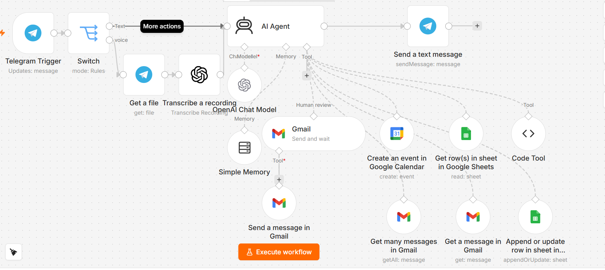

# AI-Powered Personal Assistant

I built this personal assistant with **n8n** and **OpenAI** to help manage everyday tasks through Telegram.

### What it can do
- Understand text messages and voice notes
- Help send and retrieve emails with Gmail
- Create events in Google Calendar
- Read and update Google Sheets
- Use conversation memory and human approval for selected actions

### Built with
n8n · OpenAI · Telegram · Gmail · Google Calendar · Google Sheets

### Note
Credentials and connected accounts must be configured in n8n. Never upload API keys, passwords, or private data to GitHub.
